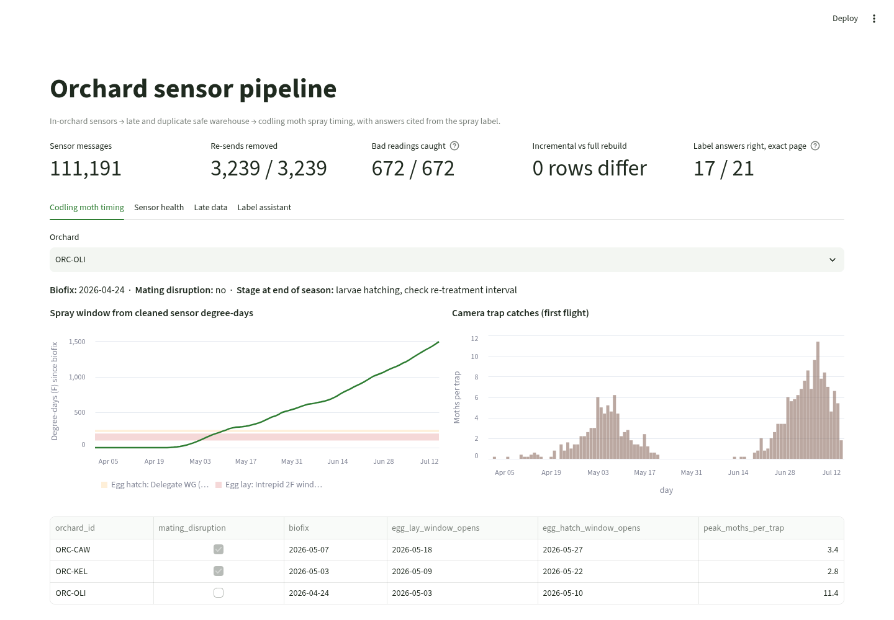
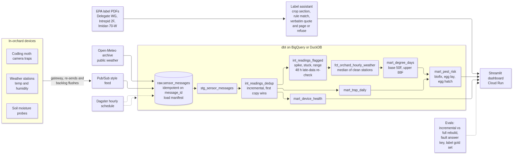
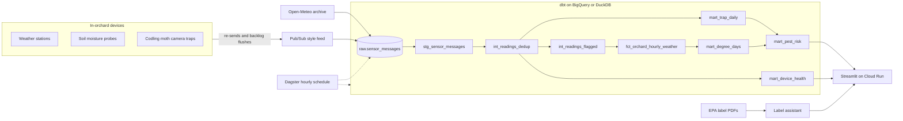
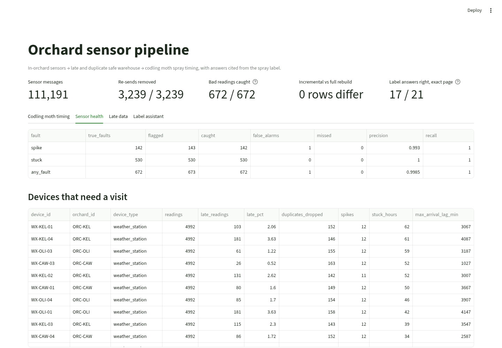
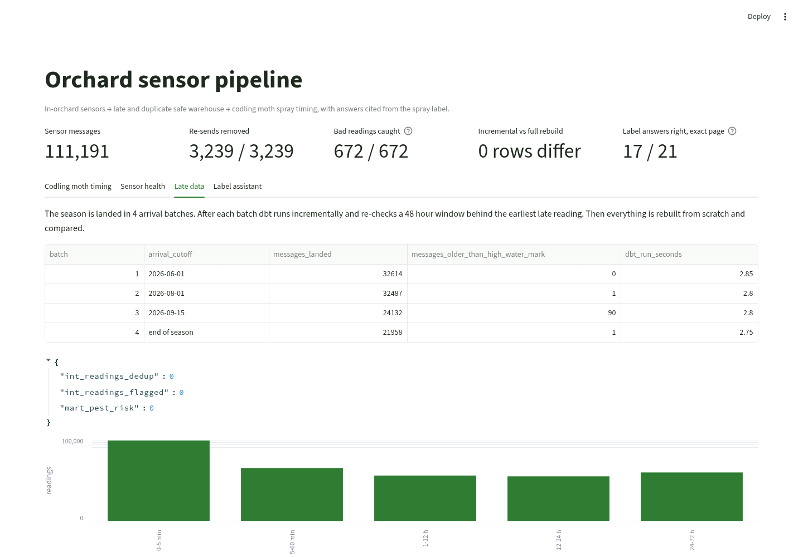
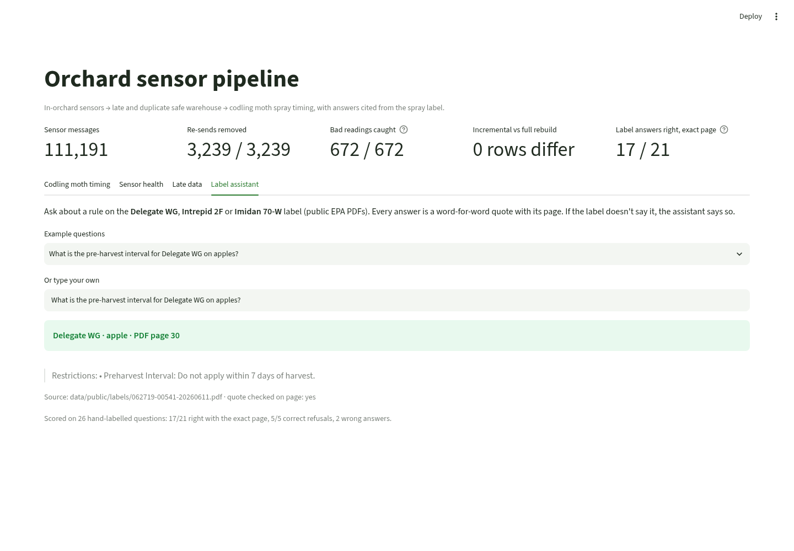

# Orchard sensor pipeline

[](https://github.com/manishreddy998/orchard-sensor-pipeline/actions/workflows/ci.yml)

Field sensors in an orchard don't send clean data. Gateways re-send messages, devices lose signal and flush hours of backlog at once, and a station can freeze or throw a wild reading. If that data goes straight into degree-day models, the spray-timing advice a grower gets can be wrong.

This project takes raw orchard sensor messages and turns them into a trusted codling moth spray window, then answers spray label questions with a word-for-word quote and page from the label.



## What it does

1. **Lands raw messages safely.** Weather stations, soil probes and codling moth camera traps publish messages. Loads are idempotent on `message_id` and logged in a load manifest.
2. **Handles duplicates and late data in dbt.** `int_readings_dedup` keeps the first copy of each reading. `int_readings_flagged` is incremental and re-checks a 48 hour window behind the earliest late reading, because a late reading can change its neighbours' flags.
3. **Flags bad readings.** It catches spikes (more than 6 C away from both neighbours), stuck sensors (6 or more identical values in a row) and out-of-range values. The orchard temperature is the median of stations that passed every check.
4. **Turns clean data into pest timing.** It calculates codling moth degree-days (base 50 F, upper 88 F) and finds biofix from trap catches (first of two days in a row with at least 1 moth per trap). It then opens the egg lay and egg hatch windows using the numbers printed on the labels:
   * Intrepid 2F (EPA 62719-442), PDF page 38: apply at egg lay, "100 to 200 DD, base 50ºF, following biofix"
   * Delegate WG (EPA 62719-541), PDF page 29: "egg hatch typically begins at 220 to 250 degree-days (base 50°F) after biofix"
5. **Answers label questions with proof.** It finds the product, the crop section (for example apples vs pears) and the rule. It returns the exact lines with their PDF page and checks the quote is really on that page. If any step fails, it refuses.

Two of the three orchards run mating disruption, so their trap catches are lower. That's why biofix comes from catches per trap and isn't hard-coded.

## Results from the actual run

All numbers come from `results/pipeline_stats.json` and `results/label_qa_stats.json`, which CI writes on every run.

| Check | Result |
|---|---|
| Sensor messages received | 111,191 |
| Gateway re-sends removed | 3,239 of 3,239 (107,952 unique readings, exactly the expected count) |
| Late readings (arrived more than 1 hour after they were taken) | 2,305 |
| Incremental runs over 4 arrival batches vs a full rebuild | 0 rows different in dedup, flags and pest risk marts |
| Spike readings caught | 142 of 142, 1 false alarm (99.3% precision, 100% recall) |
| Stuck sensor hours caught | 530 of 530, 0 false alarms |
| dbt run per batch, local DuckDB | about 3 seconds |
| Label questions answered right with the exact page | 17 of 21 (81%) |
| Questions it should refuse (unknown product, no crop, not on label) | 5 of 5 refused |
| Wrong answers given | 2 (both on the Intrepid 2F pome table) |
| Quotes found word-for-word on the cited page | 19 of 19 |

Codling moth timing from the cleaned data:

| Orchard | Mating disruption | Biofix | Egg lay window opens (100 DD) | Egg hatch window opens (220 DD) | Peak moths per trap |
|---|---|---|---|---|---|
| Kelowna block | yes | May 3 | May 9 | May 22 | 2.8 |
| Oliver block | no | Apr 24 | May 3 | May 10 | 11.4 |
| Cawston block | yes | May 7 | May 18 | May 27 | 3.4 |

**What didn't work yet.** All 4 label misses come from the Intrepid 2F pome table, where 4 columns print side by side. Plain text extraction mixes the columns, so a rule like "Do not make more than 4 applications" gets split across lines. The next step is table-aware parsing (cropping each column by its x position), then re-running the same gold set.

**Honest limits.** Sensor readings are synthetic, built on top of real Open-Meteo weather for each location, so faults can be scored against an answer key. The spikes are big (15 to 30 C), which makes them easy to catch; real faults are subtler. The labels are public US EPA labels, because the PDFs and registration numbers are public. A Canadian deployment would index PMRA labels the same way.

## Data

| Data | Source |
|---|---|
| Hourly temperature, humidity, rain, soil moisture for 3 Okanagan and Similkameen locations, Apr 1 to Oct 25 2026 | [Open-Meteo archive API](https://open-meteo.com/en/docs/historical-weather-api), cached in `data/public/open_meteo_hourly.csv` |
| 12 weather stations, 9 soil probes, 15 codling moth traps, with re-sends, signal loss, spikes and stuck sensors | `src/synth_sensors.py`, seed 42, answer key in `data/raw/fault_truth.parquet` |
| Delegate WG, Intrepid 2F, Imidan 70-W labels (126 pages) | [EPA Pesticide Product Label System](https://www3.epa.gov/pesticides/chem_search/ppls/) |
| 26 hand-labelled label questions | `data/public/label_gold.csv` |

## Architecture



Source: [docs/architecture.mmd](docs/architecture.mmd)



## Stack

* **Warehouse:** DuckDB locally. The same dbt project has a BigQuery target, where the incremental models switch to `merge` and are partitioned by day on `reading_ts` and clustered by `device_id`. The BigQuery target is configured but not run in CI.
* **Transforms:** dbt with incremental models, 16 generic and singular tests (one row per reading, flagged values never reach marts, degree-days never decrease, one biofix per orchard, arrival after reading time).
* **Orchestration:** Dagster assets and an hourly schedule in `dags/orchard_dagster.py`.
* **App:** Streamlit, light theme, with a Dockerfile for Cloud Run.
* **CI:** GitHub Actions runs the whole pipeline, both scoreboards and pytest, and checks the Dagster definitions load.

## Run it

```bash
pip install -r requirements.txt
python -m src.fetch_weather        # uses the cached CSV; add --refresh to pull again
python -m src.synth_sensors
python -m src.land --reset
python -m src.warehouse build      # dbt seed, run and test
python -m src.evaluate_pipeline    # 4 incremental batches vs full rebuild, faults scored
python -m src.evaluate_labels
pytest -q
streamlit run app/streamlit_app.py
```

Ask the label assistant from the command line:

```bash
python -m src.label_qa "What is the re-entry interval for Imidan 70-W on apples in British Columbia west of the Rockies?"
```

To use BigQuery, set `WAREHOUSE_TARGET=bigquery` and `GCP_PROJECT_ID`, then run `python -m src.warehouse build`.

## Screenshots

| Sensor health | Late data |
|---|---|
|  |  |



## Repo layout

```
src/            ingestion, fault generator, label assistant, evals
dbt/            staging, intermediate and mart models, tests, device registry seed
dags/           Dagster assets and schedule
app/            Streamlit dashboard
data/public/    Open-Meteo weather cache, EPA label PDFs, label gold set
results/        scoreboards written by the last run
```
